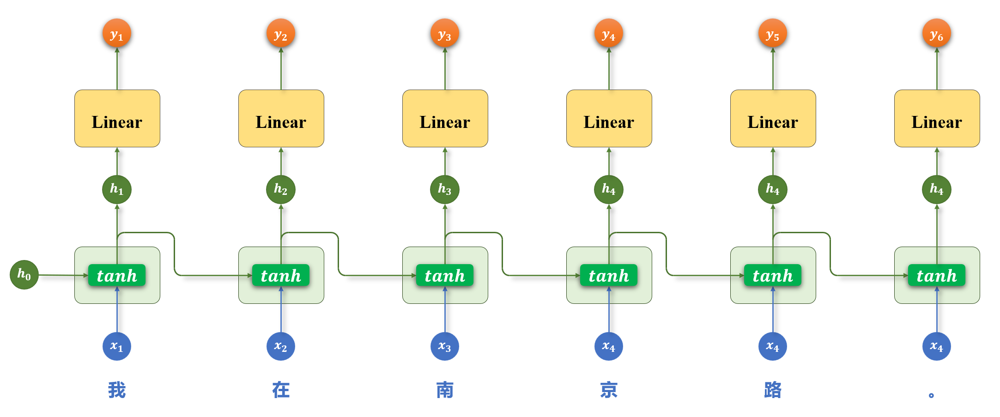

# RNN：循环神经网络

RNN（Recurrent Neural Network）按时间步处理序列，通过隐藏状态传递已读信息。文本中的时间步可以对应一个 token；同一层在各时间步共享参数。

```text
x₁ → [RNN] → h₁ → [RNN] → h₂ → [RNN] → h₃
                        ↑              ↑
                        x₂             x₃
```

## 状态与输出



*图片来源：课程讲义。原图末尾重复标为 $x_4$、$h_4$，后两步应按时间顺序理解为下标 5、6。*

给定输入 $x_t$ 和前一状态 $h_{t-1}$，普通 RNN 的一种形式为：

$$h_t=\tanh(W_xx_t+W_hh_{t-1}+b_h),\qquad y_t=W_yh_t+b_y.$$

$h_t$ 是截至当前时间步的压缩表示；输出层及激活函数由任务决定。初始状态常设为零，也可以学习。

## 多层与双向

多层 RNN 将一层各时间步的输出作为下一层的输入。双向 RNN 使用独立参数分别从左到右、从右到左处理输入，再通常拼接同一位置的状态：$h_t=[\overrightarrow h_t;\overleftarrow h_t]$。反向状态需要右侧输入，因而不适合直接用于无法看到未来信息的实时预测。

## 训练与局限

时间反向传播（BPTT）沿展开的序列传播误差。长序列中的重复链式求导可能导致梯度消失或爆炸；前者使长期依赖难以学习，后者可通过梯度裁剪缓解。LSTM 和 GRU 用门控改善信息传递。

**要点：** 隐藏状态并非完整记忆；参数跨时间共享；顺序依赖限制时间步之间的并行。

## 手算一个时间步

为观察数据如何流动，假设所有量都是标量，$x_t=1$、$h_{t-1}=0.5$、$W_x=0.4$、$W_h=0.2$、$b_h=0$，则 $h_t=\tanh(0.4+0.1)\approx0.462$。实际模型中这些量通常是向量或矩阵。$h_t$ 随后传到下一步；它也可以送到输出层。

## 双向状态与任务选择

对序列「我 / 喜欢 / 苹果」，正向状态在「喜欢」处包含已处理的「我、喜欢」，反向状态则包含「苹果、喜欢」。把这两个状态拼接，便得到该位置的双向表示。序列标注可以对每个位置分类；整句分类则需要选择或汇聚序列表示。双向模型需要右侧上下文，不能用未来词尚不可见的语言模型推理方式直接运行。

**自查：** 为什么不同时间步的参数相同？为什么输入更长时，早期信息不一定能传到最后？双向模型在什么情形下看不到右文？
