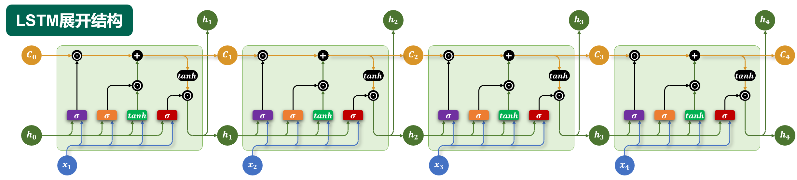

# LSTM：长短期记忆网络

LSTM（Long Short-Term Memory）维护隐藏状态 $h_t$ 和记忆单元 $c_t$，利用门控控制信息如何保留、写入与输出。令 $[h_{t-1};x_t]$ 表示拼接，$\sigma$ 为 sigmoid，$\odot$ 为逐元素相乘。

*图片来源：课程讲义。橙色水平线表示记忆单元沿时间传递，图中的乘号与加号分别对应逐元素乘法和加法。*

$$f_t=\sigma(W_f[h_{t-1};x_t]+b_f)$$
$$i_t=\sigma(W_i[h_{t-1};x_t]+b_i),\quad \tilde c_t=\tanh(W_c[h_{t-1};x_t]+b_c)$$
$$c_t=f_t\odot c_{t-1}+i_t\odot\tilde c_t$$
$$o_t=\sigma(W_o[h_{t-1};x_t]+b_o),\quad h_t=o_t\odot\tanh(c_t)$$

- **遗忘门** $f_t$：控制旧记忆保留的比例。
- **输入门** $i_t$：控制候选记忆 $\tilde c_t$ 写入的比例。
- **输出门** $o_t$：控制当前记忆对隐藏状态的影响。

记忆单元的加法更新为跨时间传递信息提供了更直接的路径，但并不保证彻底消除梯度消失。多层 LSTM 沿深度堆叠；双向 LSTM 分别计算两个方向的状态，通常在对应位置拼接。两种结构也可以结合。

## 用数值理解门控

假设某一个维度上 $c_{t-1}=0.8$、$f_t=0.5$、$i_t=0.4$、$\tilde c_t=0.5$，则 $c_t=0.5\times0.8+0.4\times0.5=0.6$。旧记忆贡献 0.4，新信息贡献 0.2。若 $o_t=0.5$，则 $h_t=0.5\tanh(0.6)\approx0.269$。这些数值仅为说明计算过程，不代表训练结果。

## 分清两个状态

$c_t$ 是沿时间传递的记忆单元状态；$h_t$ 是经过输出门过滤后的隐藏状态，可提供给下一时间步和任务输出层。两者都是向量，不应把某个门理解成只对整句话做一次开关。

**自查：** 如果遗忘门接近 1、输入门接近 0，记忆单元会如何变化？为什么输出门接近 0 并不等于记忆单元被清空？
