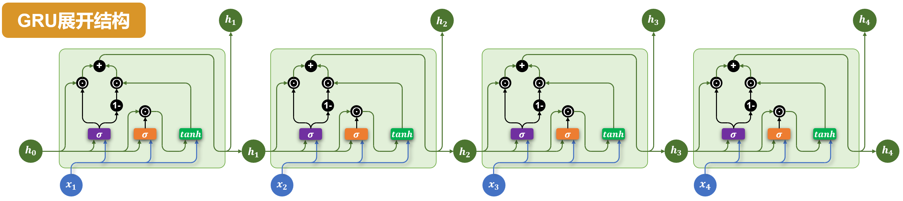

# GRU：门控循环单元

GRU（Gated Recurrent Unit）使用隐藏状态和两个门控制历史信息的使用。以下采用一种常见约定：更新门数值越大，保留的旧状态越多。

*图片来源：课程讲义。图中每个单元接收当前输入和上一步隐藏状态；两个 sigmoid 门调节状态更新。*

$$z_t=\sigma(W_zx_t+U_zh_{t-1}+b_z)$$
$$r_t=\sigma(W_rx_t+U_rh_{t-1}+b_r)$$
$$\tilde h_t=\tanh(W_hx_t+U_h(r_t\odot h_{t-1})+b_h)$$
$$h_t=z_t\odot h_{t-1}+(1-z_t)\odot\tilde h_t$$

更新门 $z_t$ 控制旧状态与候选状态的混合；重置门 $r_t$ 控制构造候选状态时使用多少历史信息。不同资料可能将更新门的混合权重定义反过来，阅读公式时应先确认约定。具体框架的候选状态计算也可能采用不同排列。

| 结构 | 核心状态 | 门控 |
|---|---|---|
| RNN | 隐藏状态 | 无 |
| LSTM | 隐藏状态、记忆单元 | 遗忘、输入、输出门 |
| GRU | 隐藏状态 | 重置、更新门 |

GRU 通常比同规模 LSTM 参数更少，但实际效果取决于任务。多层 GRU 堆叠网络层；双向 GRU 分别编码左右文并合并对应状态。

## 用数值理解更新门

对于某个状态维度，若 $h_{t-1}=0.8$、$\tilde h_t=0.2$、$z_t=0.75$，则 $h_t=0.75\times0.8+0.25\times0.2=0.65$。这个例子里旧状态权重更高；若更新门接近 0，则候选状态的影响更大。计算是逐元素进行的，不同维度的门值可以不同。

重置门接近 0 时，按上述公式构造候选状态时相应维度的旧状态贡献被抑制；它不直接把最终的 $h_t$ 清零。GRU 没有 LSTM 那样单独传递的 $c_t$。

**自查：** 更新门和重置门分别影响哪一步？遇到与本笔记相反的更新门定义，应该如何判断旧状态的权重？
