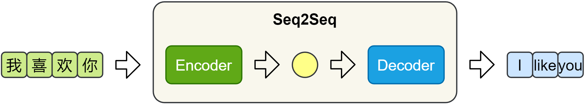

# Seq2Seq：序列到序列

Seq2Seq（Sequence-to-Sequence）把输入序列映射为输出序列，二者长度可以不同。机器翻译中，Encoder 读取源句，Decoder 逐步生成目标句。



*图片来源：课程讲义。黄色圆形代表从编码器传递到解码器的上下文信息。*

```text
源句 tokens → Encoder → context vector → Decoder → 目标句 tokens
                                      ↑
                              前一个目标 token
```

在基础 RNN Encoder–Decoder 中，编码器可用最终状态构造上下文向量 $c$：

$$h_t=\operatorname{Encoder}(x_t,h_{t-1}),\qquad c=h_T.$$

解码器根据上下文、之前的状态和前一个目标 token 计算新状态，再预测当前 token：

$$s_t=\operatorname{Decoder}(y_{t-1},s_{t-1},c),\qquad P(y_t)=\operatorname{softmax}(W s_t+b).$$

具体模型可以用 $c$ 初始化解码器状态，或将其作为每一步的额外输入。生成通常从起始符开始，遇到结束符停止。训练时可以使用 teacher forcing，即向解码器提供真实的前一个目标 token；推理时则使用已生成的 token。

固定长度上下文向量可能成为长句的信息瓶颈；Attention 是后续学习中处理这一问题的重要方法。本笔记只记录基本流程，尚无完整机器翻译训练实验。

## 一个翻译过程

以「我喜欢你」→「I like you」为例，编码器先处理中文 token；解码器从 `<BOS>` 开始预测 `I`，再依次根据已有目标词预测 `like`、`you` 和 `<EOS>`。实际结果由模型和解码策略决定，此处只是流程示例。

训练时目标序列可以右移构造输入：`<BOS> I like you`；对应预测目标是 `I like you <EOS>`。在 teacher forcing 下，下一步喂入真实的前一个 token；推理时没有真实目标可用，需要使用模型自身生成的 token。这种输入差异可能使推理阶段的错误不断影响后续输出。

## 检查理解

1. 编码器最终状态为什么可以作为一种上下文表示？它是否保证完整保留源句信息？
2. `<BOS>` 和 `<EOS>` 分别解决什么问题？
3. 为什么目标句和源句可以长度不同？teacher forcing 与推理的输入有何区别？
