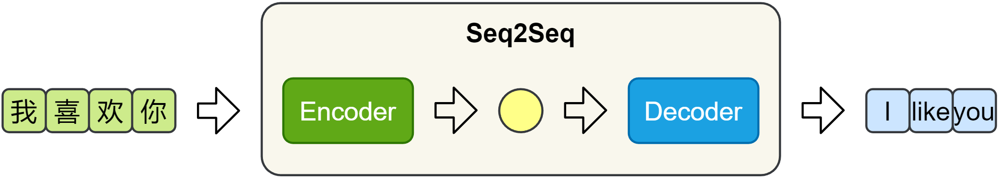

# NLP Learning Notes — Seq2Seq

- **Topic:** Sequence-to-Sequence Models
- **Status:** Theory Completed
- **Next Topic:** Attention Mechanism

## 1. Seq2Seq Overview

Seq2Seq（Sequence to Sequence）是一种将输入序列转换为输出序列的模型框架。输入和输出序列的长度可以不同。主要应用包括机器翻译（Machine Translation）、文本摘要（Text Summarization）、问答系统（Question Answering）和对话系统（Dialogue Systems）。

### Basic Architecture

经典 Seq2Seq 由 Encoder 和 Decoder 组成：



*图片来源：课程讲义。图中黄色圆形表示传递给 Decoder 的上下文信息。*

- **Encoder（编码器）：**处理输入序列，可以使用 RNN、LSTM 或 GRU，并将信息编码为固定长度的 Context Vector。基本结构通常利用编码器最终隐藏状态表示上下文信息。
- **Decoder（解码器）：**根据上下文信息逐个预测输出 token，通常从 `<sos>` 开始，到 `<eos>` 结束。

```text
Input Sequence → Encoder → Context Vector → Decoder → Output Sequence
```

## 2. Special Tokens

| Token | Meaning | Function |
| --- | --- | --- |
| `<sos>` | Start of Sequence | 告诉 Decoder 开始生成 |
| `<eos>` | End of Sequence | 表示序列结束 |

例如，目标翻译 `I like you` 添加特殊标记后为：`<sos> I like you <eos>`。

## 3. Teacher Forcing

Teacher Forcing（教师强制）是一种训练策略：训练 Decoder 时，下一步输入真实目标序列中的前一个 token，而不是模型上一步的预测结果。

| Step | Decoder Input | Target Output |
| --- | --- | --- |
| 1 | `<sos>` | I |
| 2 | I | like |
| 3 | like | you |
| 4 | you | `<eos>` |

即使第一步错误预测为 `You`，第二步仍使用真实答案 `I`。这种策略避免模型预测错误在训练输入中连续累积，有助于稳定训练，并帮助模型学习目标序列的条件概率关系。

## 4. Training vs Inference

### Training（训练）

通常采用 Teacher Forcing：Encoder 编码输入；Decoder 使用真实的前一个 token，预测目标 token 的概率分布；使用交叉熵损失（Cross-Entropy Loss）计算误差，并通过反向传播更新参数。

单个正确 token 的交叉熵损失为：

$$
L_t = -\log P(y_t)
$$

### Inference（推理）

采用自回归生成（Autoregressive Generation）：从 `<sos>` 开始预测，将生成的 token 作为下一步输入，直到生成 `<eos>` 或达到最大生成长度。

**核心区别：**训练时通常使用真实目标词；推理时使用模型自己生成的词。

## 5. Decoding Strategies

### 5.1 Greedy Decoding

贪心解码每一步选择当前概率最高的 token。它计算简单、速度快、开销较小，但容易陷入局部最优；当前最优选择不一定形成整体最优序列，生成结果的多样性也有限。

### 5.2 Beam Search

束搜索在每一步保留多个候选序列；`beam_size` 决定保留的候选路径数量。例如，`beam_size=3` 时，每一步保留得分较高的三个候选序列，再继续扩展和筛选。

序列概率可表示为：

$$
P(y_1,\ldots,y_T\mid x)=\prod_{t=1}^{T}P(y_t\mid y_{<t},x)
$$

Beam Search 根据候选路径的累计得分选择较优序列，通常使用对数概率计算。它能探索多个候选序列，有机会获得比贪心解码更高得分的完整序列，但计算开销更大，也不保证找到全局最优；更大的 beam size 不一定意味着更好的自然语言质量。

## 6. Limitations of Traditional Seq2Seq

### 6.1 Information Bottleneck

传统 Encoder 将整个输入序列压缩为固定长度的 Context Vector。输入很长时，该向量可能难以充分保留所有重要信息，形成信息瓶颈（Information Bottleneck）。

### 6.2 Lack of Dynamic Attention

传统 Decoder 主要依赖同一个固定上下文向量，但生成不同目标词时可能需要参考源序列的不同位置。例如，生成 `I`、`like`、`apples` 时，分别可能更需要参考「我」「喜欢」「苹果」。固定向量结构缺少显式的动态位置选择机制，可能影响长序列生成质量。

## 7. Introduction to Attention

Attention Mechanism（注意力机制）旨在缓解上述问题：Decoder 在生成每个目标 token 时，根据当前解码状态动态参考 Encoder 各时间步的隐藏状态。它可以选择相关源序列信息，缓解固定上下文向量的信息瓶颈，并帮助建立输入和输出位置之间的对齐关系。

**当前进度：**仅理解 Attention 的设计动机，尚未系统学习注意力评分、Softmax 和加权求和公式。

## 8. Key Takeaways

1. Seq2Seq = Encoder + Decoder：前者提取输入序列信息，后者生成目标序列。
2. Teacher Forcing 在训练时使用真实的前一个 token；自回归推理使用模型自己生成的前一个 token。
3. Greedy Decoding 每一步选择当前概率最高的 token；Beam Search 保留多个候选序列并根据累计得分筛选。
4. 经典 Seq2Seq 存在信息瓶颈和缺乏动态关注的问题；Attention 通过动态参考源序列信息缓解这些问题。

## 9. Learning Progress

- **Completed:** Seq2Seq 基本架构、Encoder 与 Decoder、Context Vector、Teacher Forcing、Autoregressive Generation、Greedy Decoding、Beam Search、Seq2Seq 的主要局限。
- **In Progress:** Attention Mechanism。
- **Planned:** Attention Score、Softmax Attention Weights、Weighted Sum、Attention-based Seq2Seq、Transformer Architecture。

---

本笔记根据学习内容和个人学习过程整理，用于记录理论理解。目前尚未完成独立的 Seq2Seq 模型训练实验。
